<picture>
  <source media="(prefers-color-scheme: dark)" srcset="assets/telemetry-dark.svg">
  
</picture>

### Hi, I'm Pau 👋

Space Engineering student at UPV in Valencia, writing ground-station and flight software for **Faraday Rocketry**: telemetry simulation, the flight monitoring dashboard, and the shared libraries behind them. Mostly Python, Svelte and C, with the occasional Minecraft mod on the side.

<picture>
  <source media="(prefers-color-scheme: dark)" srcset="assets/flight-profile-dark.svg">
  
</picture>

<b>How to read the telemetry</b>

 

| Readout | Meaning |
| --- | --- |
| **Altitude** | Contributions since 1 January (T‑0) |
| **Velocity** | Contributions in the last 7 days |
| **Acceleration** | Change versus the previous 7 days |
| **Flight phase** | `BOOST` speeding up · `COAST` steady · `APOGEE` best week in two months · `DESCENT` slowing down · `RECOVERY` under parachutes |
| **MET** | Mission elapsed time since T‑0 |

Everything is regenerated daily by a GitHub Action from the GitHub API. No external services involved.

## Mission patches

<!-- PATCHES:START -->
<table align="center">
<tr><td align="center" width="33%"> Faraday Rocketry flight monitoring dashboard: 50 Hz WebSocket telemetry, Svelte + ECharts frontend.</td><td align="center" width="33%"> Python/Tkinter generator that simulates and streams serial telemetry for ground-station testing.</td><td align="center" width="33%"> Faraday Rocketry's shared code library.</td></tr>
<tr><td align="center" width="33%"> Personal project.</td><td align="center" width="33%"> Contribution to FabricMC: saving a world's active mod list.</td><td align="center" width="33%"> Skills I've adapted for Claude.</td></tr>
</table>
<!-- PATCHES:END -->

## Launch pad

Every visitor gets a launch. Pick a motor, open the pre-filled issue, and a GitHub Action flies your rocket through a 1D simulation (thrust curve, variable mass, drag with altitude-dependent air density) and replies with the flight data.

  <a href="https://github.com/Pauverblom/Pauverblom/issues/new?title=launch&body=Pick%20a%20motor%20class%20by%20editing%20the%20last%20line%20%28G%2C%20H%2C%20I%2C%20J%20or%20K%29%2C%20then%20press%20%2A%2ACreate%2A%2A.%0AFlight%20results%20show%20up%20as%20a%20comment%20in%20about%20a%20minute.%0A%0Amotor%3A%20I"><b>🚀 Launch a rocket</b></a>

<!-- LEADERBOARD:START -->

The pad is clear. No launches yet, so the first one takes the top spot.

<!-- LEADERBOARD:END -->
